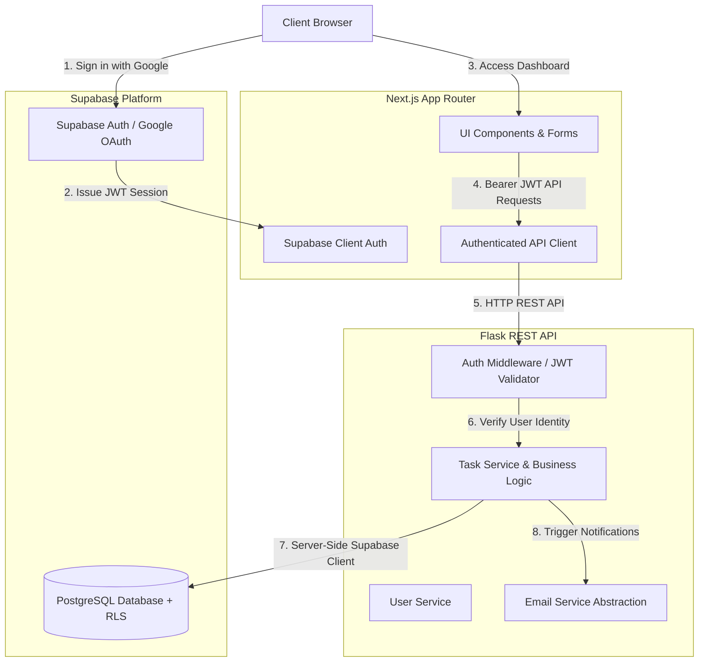
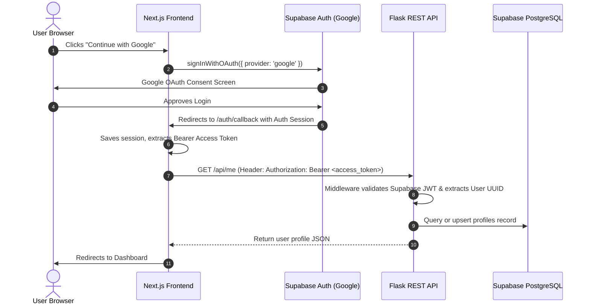
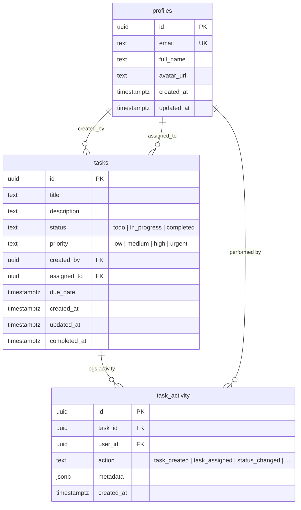

# TaskFlow Pro — Full-Stack Task Management Platform

A production-grade, enterprise-ready collaborative Task Management Application built with **Next.js (App Router, TypeScript, Tailwind CSS)**, a modular **Python Flask REST API**, and **Supabase (PostgreSQL, Auth, Row Level Security)**.

---

## Architecture Overview



### Core Architecture Principles
1. **Frontend Role**: Next.js App Router serves as the presentation and routing tier. It handles authentication sessions, forms, responsive UI states, and calls the Flask backend. It does **not** bypass the backend to perform raw business mutations.
2. **Backend Authority**: The Flask REST API owns all business rules, task mutations, team assignments, validation, authorization checks, audit activity logging, and notification dispatch.
3. **Decoupled Security**:
   - The browser client connects only with `NEXT_PUBLIC_SUPABASE_PUBLISHABLE_KEY`.
   - The backend holds `SUPABASE_SERVICE_ROLE_KEY` to execute authorized operations after validating the client's Bearer token.
   - The `SUPABASE_SERVICE_ROLE_KEY` is strictly server-only and is **never** exposed to the client.

---

## Tech Stack

| Tier | Technologies |
|---|---|
| **Frontend** | Next.js 16 (App Router), React 19, TypeScript, Tailwind CSS, Lucide React, `@supabase/supabase-js` |
| **Backend** | Python 3.12, Flask 3.1, Flask-CORS, `supabase-py`, `gotrue`, `python-dotenv`, Pytest |
| **Database & Auth** | Supabase PostgreSQL, Row Level Security (RLS), Google OAuth via Supabase Auth |
| **Email Architecture** | Provider-agnostic abstraction (`EmailService`) with support for Resend, Gmail API, or Mock mode |

---

## Project Structure

```text
TASK MANAGEMENT APP/
├── .env.example              # Documented environment template for root & services
├── .gitignore                 # Universal ignore rules (Next.js, Python, secrets)
├── README.md                  # System documentation and execution guide
│
├── frontend/                  # Next.js App Router Frontend
│   ├── src/
│   │   ├── app/
│   │   │   ├── page.tsx       # Landing & welcome interface
│   │   │   ├── login/         # Google OAuth login screen
│   │   │   ├── auth/callback/ # Supabase OAuth redirect handler
│   │   │   ├── dashboard/     # Metrics, tasks due soon, recent activity
│   │   │   └── tasks/
│   │   │       ├── new/       # Task creation form
│   │   │       └── [id]/      # Task details, status change & audit timeline
│   │   ├── components/
│   │   │   ├── layout/        # Sidebar, topbar, navigation
│   │   │   ├── tasks/         # Task cards, badges, filter controls
│   │   │   ├── dashboard/     # Summary metrics, recent lists
│   │   │   └── ui/            # Buttons, dialogs, badges, inputs
│   │   ├── lib/
│   │   │   ├── supabase.ts    # Browser Supabase client
│   │   │   └── api.ts         # Authenticated fetch wrapper with Bearer JWT
│   │   └── types/
│   │       └── index.ts       # Shared TypeScript schemas & API types
│   ├── package.json
│   ├── tsconfig.json
│   └── .env.example
│
├── backend/                   # Python Flask REST API
│   ├── app/
│   │   ├── __init__.py        # App factory, CORS & centralized error handlers
│   │   ├── config.py          # Configuration parser & validator
│   │   ├── middleware/
│   │   │   └── auth.py        # Supabase JWT authentication decorator
│   │   ├── routes/
│   │   │   ├── health.py      # /api/health endpoint
│   │   │   ├── users.py       # /api/users & user search
│   │   │   └── tasks.py       # Task CRUD, complete, activity routes
│   │   ├── services/
│   │   │   ├── task_service.py   # Task business logic & authorization
│   │   │   ├── user_service.py   # Profile synchronization & lookup
│   │   │   └── email_service.py  # Decoupled notification dispatcher
│   │   └── utils/
│   │       └── responses.py   # Standard success/error JSON response envelopes
│   ├── tests/
│   │   ├── __init__.py
│   │   └── test_health.py     # Endpoint and logic test suites
│   ├── requirements.txt       # Python package dependencies
│   ├── run.py                 # Development server entry point
│   └── .env.example
│
└── migrations/                # Version-controlled SQL database schema
    ├── README.md              # Migration execution guide
    ├── 001_initial_schema.sql # Profiles & tasks tables
    ├── 002_add_indexes.sql    # Performance indexes
    ├── 003_add_task_activity.sql # Audit activity tracking
    └── 004_rls_policies.sql   # Supabase Row Level Security rules
```

---

## Authentication Flow



---

## API Documentation

All API responses follow a consistent JSON envelope:

#### Standard Success Response
```json
{
  "success": true,
  "data": { ... }
}
```

#### Standard Error Response
```json
{
  "success": false,
  "error": {
    "code": "TASK_NOT_FOUND",
    "message": "Task not found",
    "details": null
  }
}
```

### Endpoints Overview

| Method | Endpoint | Auth | Description |
|---|---|---|---|
| `GET` | `/api/health` | Public | Service health verification (`{"status": "ok"}`) |
| `GET` | `/api/me` | Bearer Token | Returns the authenticated user's profile |
| `GET` | `/api/users` | Bearer Token | Lists registered users eligible for assignment |
| `GET` | `/api/users/search?q=` | Bearer Token | Searches users by name or email |
| `GET` | `/api/tasks` | Bearer Token | Lists tasks (supports `status`, `priority`, `assigned_to`, `created_by`, `search`, `sort`, `page`, `limit`) |
| `POST` | `/api/tasks` | Bearer Token | Creates a new task (`created_by` derived from token) |
| `GET` | `/api/tasks/<task_id>` | Bearer Token | Returns single task details and activity |
| `PATCH` | `/api/tasks/<task_id>` | Bearer Token | Updates task title, description, priority, assignee |
| `POST` | `/api/tasks/<task_id>/complete` | Bearer Token | Marks task as completed, sets `completed_at` |
| `DELETE` | `/api/tasks/<task_id>` | Bearer Token | Deletes task (authorized creator only) |
| `GET` | `/api/tasks/<task_id>/activity` | Bearer Token | Returns chronological activity audit log |

---

## Database Schema



---

## Local Development Setup

### 1. Prerequisites
- **Node.js**: v20+ or v24+
- **Python**: 3.11+ or 3.12+
- **Git**
- A free account on [Supabase](https://supabase.com)

### 2. Environment Configuration
Create environment files from templates:
```bash
# Frontend
cp frontend/.env.example frontend/.env.local

# Backend
cp backend/.env.example backend/.env
```

Fill in your Supabase project URL and keys:
- `frontend/.env.local`: `NEXT_PUBLIC_SUPABASE_URL`, `NEXT_PUBLIC_SUPABASE_PUBLISHABLE_KEY`
- `backend/.env`: `SUPABASE_URL`, `SUPABASE_SERVICE_ROLE_KEY`

### 3. Running the Frontend
```bash
cd frontend
npm install
npm run dev
```
The Next.js application will be available at [http://localhost:3000](http://localhost:3000).

### 4. Running the Backend
```bash
cd backend
python -m venv venv

# Windows:
.\venv\Scripts\activate
# macOS/Linux:
source venv/bin/activate

pip install -r requirements.txt
python run.py
```
The Flask REST API will be running at [http://localhost:5000](http://localhost:5000). Verify by navigating to [http://localhost:5000/api/health](http://localhost:5000/api/health).

### 5. Running Backend Tests
```bash
cd backend
.\venv\Scripts\pytest
```

---

## Security Considerations

1. **Service Role Key Isolation**: The Supabase Service Role Key bypasses all Row Level Security policies. It is loaded only on the Flask backend via `SUPABASE_SERVICE_ROLE_KEY`. It is never exported to or referenced by the Next.js frontend.
2. **Token Verification**: Flask authenticates every incoming request by decoding and validating the Bearer JWT against Supabase's auth service.
3. **No Client Identity Spoofing**: `created_by` and actor UUIDs are extracted directly from the verified JWT, preventing malicious clients from submitting arbitrary user IDs.
4. **CORS Hardening**: Flask restricts Cross-Origin Resource Sharing specifically to `FRONTEND_URL` (e.g. `http://localhost:3000` in dev). Wildcards (`*`) are disallowed.
5. **Safe Error Masking**: Centralized Flask error handlers return sanitized JSON messages and omit internal stack traces from client responses.

---

## Phased Development Roadmap

- [x] **Phase 1**: Project initialization, directory structure, Next.js & Flask setup, environment templates, health check, baseline tests.
- [ ] **Phase 2**: Supabase database migrations, tables (`profiles`, `tasks`, `task_activity`), indexes, and RLS policies.
- [ ] **Phase 3**: Google OAuth integration via Supabase Auth and auth callback handling.
- [ ] **Phase 4**: Flask JWT authentication middleware and user context injection.
- [ ] **Phase 5**: User profile synchronization and assignment search APIs.
- [ ] **Phase 6**: Core Task CRUD endpoints and validation.
- [ ] **Phase 7**: Backend authorization enforcement (creator vs. assignee privileges).
- [ ] **Phase 8**: Task assignment logic and team delegation.
- [ ] **Phase 9**: Frontend dashboard metrics, recent tasks, and tasks due soon.
- [ ] **Phase 10**: Search, filtering, and sorting engine.
- [ ] **Phase 11**: Real-time activity audit history and timeline UI.
- [ ] **Phase 12**: Decoupled email notification service abstraction.
- [ ] **Phase 13**: End-to-end test suite (health, auth, authorization, edge cases).
- [ ] **Phase 14**: Security audit, CORS verification, and input sanitation check.
- [ ] **Phase 15**: Production deployment configuration (Vercel + Railway/Render).
- [ ] **Phase 16**: Final documentation and submission review.
