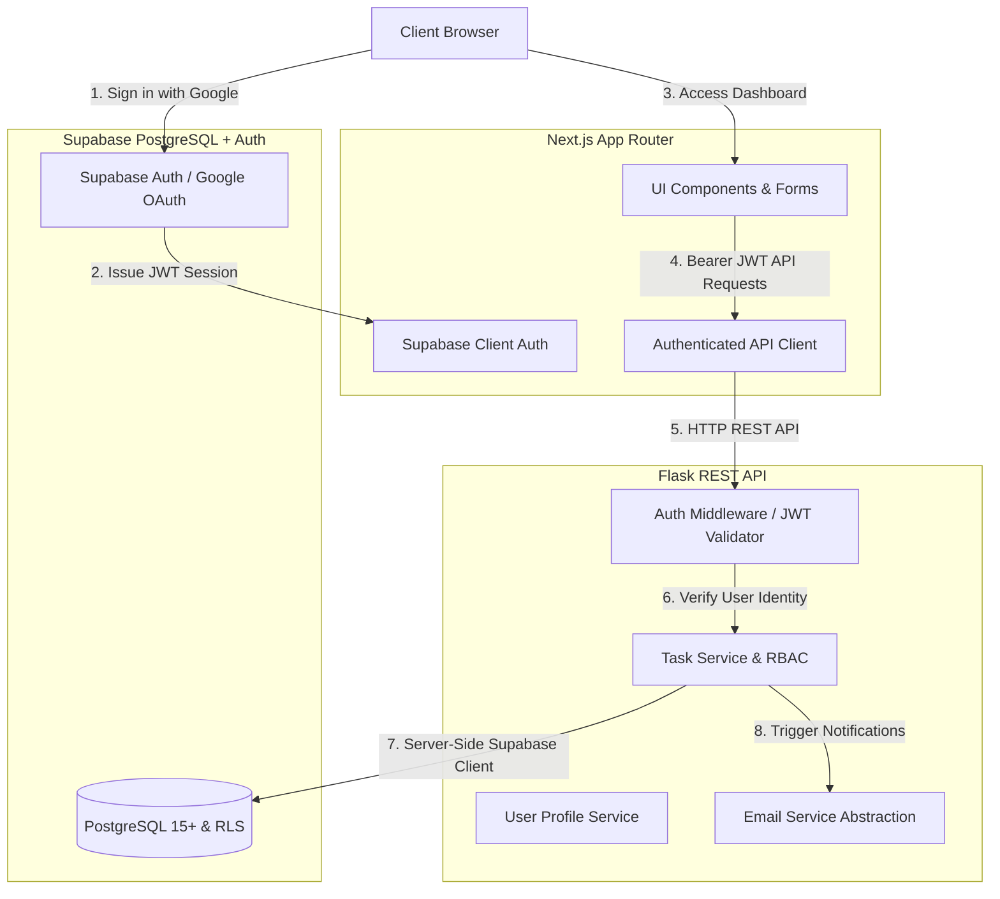
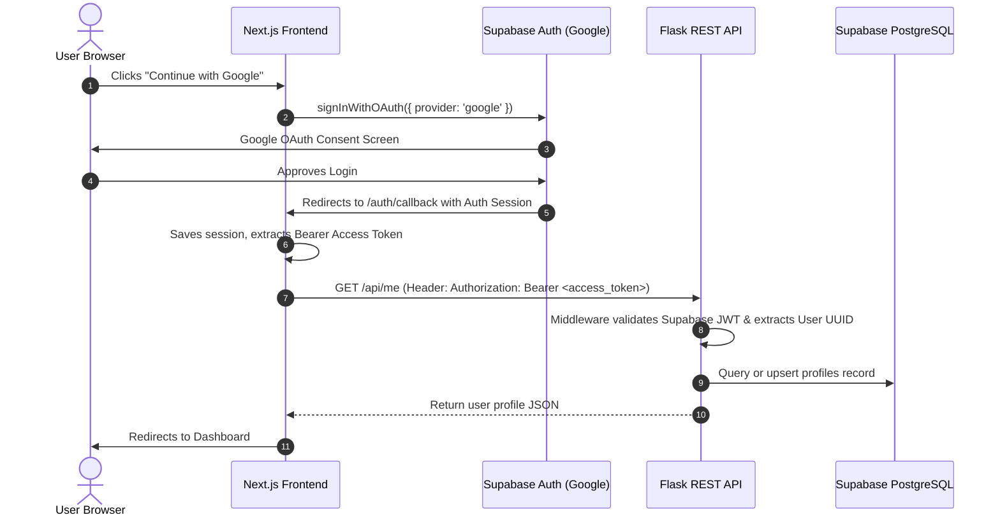
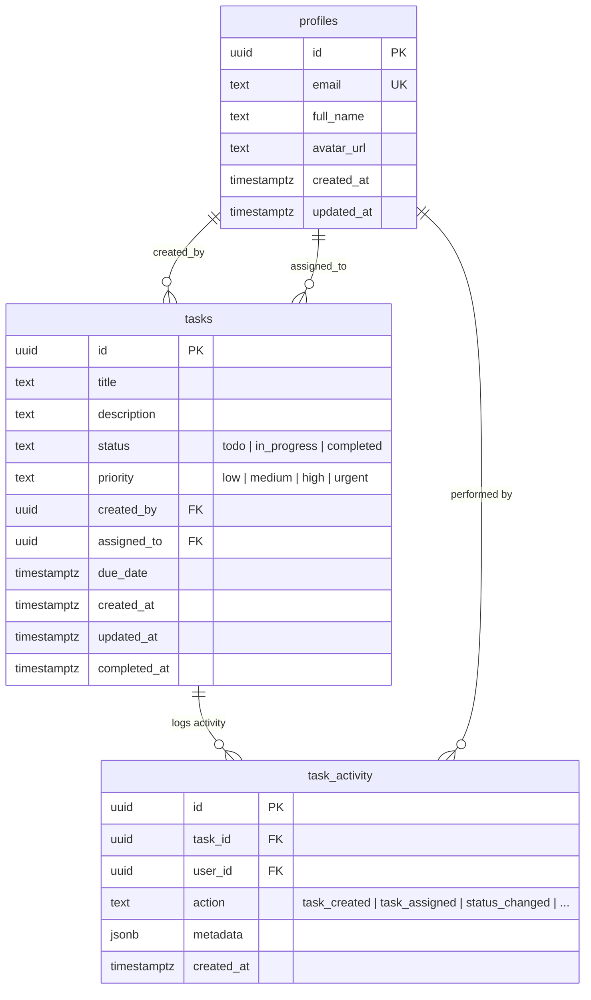

# TaskFlow Pro — Full-Stack Task Management Platform

A production-grade, enterprise-ready collaborative Task Management Application built with **Next.js (App Router, TypeScript, Tailwind CSS)**, a modular **Python Flask REST API**, and **Supabase (PostgreSQL, Auth, Row Level Security)**.

---

## 1. Architecture Overview



### Core Architectural Decisions
1. **Frontend Role**: Next.js App Router serves as the presentation and routing tier. It handles authentication sessions, forms, responsive UI states, and calls the Flask backend. It does **not** bypass the backend to perform raw business mutations.
2. **Backend Authority**: The Flask REST API owns all business rules, task mutations, team assignments, validation, authorization checks, audit activity logging, and notification dispatch.
3. **Decoupled Security**:
   - The browser client connects only with `NEXT_PUBLIC_SUPABASE_PUBLISHABLE_KEY`.
   - The backend holds `SUPABASE_SERVICE_ROLE_KEY` to execute authorized operations after validating the client's Bearer token.
   - The `SUPABASE_SERVICE_ROLE_KEY` is strictly server-only and is **never** exposed to the client.

---

## 2. Tech Stack

| Tier | Technologies |
|---|---|
| **Frontend** | Next.js 16 (App Router), React 19, TypeScript, Tailwind CSS, Lucide React, `@supabase/supabase-js`, `@supabase/ssr` |
| **Backend** | Python 3.12, Flask 3.1, Flask-CORS, Gunicorn, `supabase-py`, `gotrue`, `python-dotenv`, Pytest |
| **Database & Auth** | Supabase PostgreSQL, Row Level Security (RLS), Google OAuth via Supabase Auth |
| **Email Architecture** | Provider-agnostic abstraction (`EmailService`) with support for Resend, Gmail API, or Mock mode |
| **Deployment** | Vercel (Frontend), Render / Railway (Backend), Supabase (Database & Auth) |

---

## 3. Project Structure

```text
TASK MANAGEMENT APP/
├── .env.example              # Documented environment template for root & services
├── .gitignore                 # Universal ignore rules (Next.js, Python, secrets)
├── README.md                  # System documentation and execution guide
├── render.yaml                # Declarative Render Blueprint for backend deployment
│
├── frontend/                  # Next.js App Router Frontend
│   ├── src/
│   │   ├── app/
│   │   │   ├── page.tsx       # Landing & welcome interface
│   │   │   ├── layout.tsx     # Root layout with AuthProvider & metadata
│   │   │   ├── login/         # Google OAuth login screen
│   │   │   ├── auth/callback/ # Supabase OAuth redirect handler
│   │   │   ├── dashboard/     # Summary metrics, tasks due soon, task list
│   │   │   └── tasks/
│   │   │       ├── new/       # Task creation form with user picker
│   │   │       └── [id]/      # Task details, inline edit, status toggle, activity log
│   │   ├── components/
│   │   │   ├── layout/        # Responsive AppLayout, Sidebar, Navbar
│   │   │   ├── ui/            # StatusBadge, PriorityBadge, ConfirmationModal
│   │   ├── lib/
│   │   │   ├── supabase.ts    # Browser Supabase client
│   │   │   ├── auth-context.tsx # Auth provider & useAuth hook
│   │   │   └── api.ts         # Authenticated fetch client forwarding Bearer token
│   │   └── types/
│   │       └── index.ts       # Shared TypeScript schemas & API types
│   ├── package.json
│   ├── tsconfig.json
│   └── .env.example
│
├── backend/                   # Python Flask REST API
│   ├── app/
│   │   ├── __init__.py        # App factory, CORS & centralized error handlers
│   │   ├── config.py          # Configuration parser & validator
│   │   ├── middleware/
│   │   │   └── auth.py        # Supabase JWT authentication decorator (@require_auth)
│   │   ├── routes/
│   │   │   ├── health.py      # /api/health endpoint
│   │   │   ├── users.py       # /api/me, /api/users, /api/users/search
│   │   │   └── tasks.py       # Task CRUD, complete, delete, activity routes
│   │   ├── services/
│   │   │   ├── task_service.py   # Task business logic & RBAC authorization
│   │   │   ├── user_service.py   # Profile synchronization & lookup
│   │   │   └── email_service.py  # Decoupled notification dispatcher
│   │   └── utils/
│   │       ├── responses.py   # Standard success/error JSON response envelopes
│   │       └── supabase_client.py # Singleton Supabase client
│   ├── tests/
│   │   ├── __init__.py
│   │   ├── test_health.py     # Health endpoint verification
│   │   ├── test_auth_and_users.py # Auth failure & user sync tests
│   │   └── test_tasks_and_authorization.py # RBAC, CRUD & validation test suite
│   ├── requirements.txt       # Python package dependencies
│   ├── run.py                 # Development server entry point
│   ├── Procfile               # Production WSGI entry point
│   └── .env.example
│
└── migrations/                # Version-controlled SQL database schema
    ├── README.md              # Migration execution guide
    ├── 001_initial_schema.sql # Profiles & tasks tables
    ├── 002_add_indexes.sql    # Performance B-Tree indexes
    ├── 003_add_task_activity.sql # Audit activity tracking
    └── 004_rls_and_triggers.sql # Row Level Security policies & auth trigger
```

---

## 4. Authentication Flow



---

## 5. API Documentation

All API responses follow a consistent JSON envelope:

#### Standard Success Response
```json
{
  "success": true,
  "data": { ... }
}
```

#### Standard Error Response
```json
{
  "success": false,
  "error": {
    "code": "TASK_NOT_FOUND",
    "message": "Task not found",
    "details": null
  }
}
```

### Endpoints Specification

#### 1. Service Health
- **Method:** `GET`
- **Path:** `/api/health`
- **Auth:** Public
- **Response (200):**
  ```json
  { "status": "ok" }
  ```

#### 2. Current User Profile
- **Method:** `GET`
- **Path:** `/api/me`
- **Auth:** Bearer Token
- **Response (200):**
  ```json
  {
    "success": true,
    "data": {
      "id": "3fa85f64-5717-4562-b3fc-2c963f66afa6",
      "email": "user@example.com",
      "full_name": "Jane Doe",
      "avatar_url": "https://...",
      "created_at": "2026-10-05T18:00:00Z"
    }
  }
  ```
- **Errors:** 401 `UNAUTHENTICATED`

#### 3. List Assignable Users
- **Method:** `GET`
- **Path:** `/api/users`
- **Auth:** Bearer Token
- **Response (200):**
  ```json
  {
    "success": true,
    "data": [
      {
        "id": "3fa85f64-5717-4562-b3fc-2c963f66afa6",
        "email": "user@example.com",
        "full_name": "Jane Doe",
        "avatar_url": "https://..."
      }
    ]
  }
  ```

#### 4. Search Users
- **Method:** `GET`
- **Path:** `/api/users/search?q={query}`
- **Auth:** Bearer Token
- **Query Params:** `q` (string)
- **Response (200):** List of matching user objects (max 20).

#### 5. List Tasks
- **Method:** `GET`
- **Path:** `/api/tasks`
- **Auth:** Bearer Token
- **Query Params:**
  - `status`: `todo` | `in_progress` | `completed`
  - `priority`: `low` | `medium` | `high` | `urgent`
  - `assigned_to`: `me` or specific UUID
  - `created_by`: `me` or specific UUID
  - `search`: string (matches title or description)
  - `sort`: `newest` | `oldest` | `due_soon` | `priority`
  - `page`: integer (default 1)
  - `limit`: integer (default 50)
- **Response (200):**
  ```json
  {
    "success": true,
    "data": {
      "tasks": [...],
      "total": 12,
      "page": 1,
      "limit": 50
    }
  }
  ```

#### 6. Create Task
- **Method:** `POST`
- **Path:** `/api/tasks`
- **Auth:** Bearer Token
- **Request Body:**
  ```json
  {
    "title": "Complete backend API",
    "description": "Implement authentication and task services",
    "priority": "high",
    "assigned_to": "3fa85f64-5717-4562-b3fc-2c963f66afa6",
    "due_date": "2026-10-10T18:00:00Z"
  }
  ```
- **Response (201):** Newly created task object.
- **Errors:**
  - 400 `VALIDATION_ERROR` (title empty, invalid priority, bad date format)
  - 404 `USER_NOT_FOUND` (assigned_to user doesn't exist)

#### 7. Get Task Details
- **Method:** `GET`
- **Path:** `/api/tasks/{task_id}`
- **Auth:** Bearer Token
- **Response (200):** Task details with populated `creator`, `assignee`, and chronological `activity` timeline.
- **Errors:**
  - 400 `INVALID_ID`
  - 404 `TASK_NOT_FOUND`
  - 403 `FORBIDDEN` (user is neither creator nor assignee)

#### 8. Update Task
- **Method:** `PATCH`
- **Path:** `/api/tasks/{task_id}`
- **Auth:** Bearer Token
- **Request Body:** Partial task fields (`title`, `description`, `priority`, `status`, `assigned_to`, `due_date`).
- **Authorization Rules:**
  - Creator: can modify all fields.
  - Assignee: can **only** modify `status`.
- **Errors:**
  - 403 `FORBIDDEN` (assignee attempting to edit non-status fields, or unauthorized user)
  - 400 `VALIDATION_ERROR`
  - 404 `TASK_NOT_FOUND`

#### 9. Complete Task
- **Method:** `POST`
- **Path:** `/api/tasks/{task_id}/complete`
- **Auth:** Bearer Token
- **Response (200):** Updated task with `status = 'completed'` and `completed_at` timestamp.
- **Errors:** 403 `FORBIDDEN` (if user is neither creator nor assignee).

#### 10. Delete Task
- **Method:** `DELETE`
- **Path:** `/api/tasks/{task_id}`
- **Auth:** Bearer Token
- **Authorization Rules:** Only the task **creator** can delete.
- **Response (200):** `{"deleted": true, "task_id": "..."}`
- **Errors:** 403 `FORBIDDEN` (if assignee or outsider attempts deletion).

#### 11. Task Activity History
- **Method:** `GET`
- **Path:** `/api/tasks/{task_id}/activity`
- **Auth:** Bearer Token
- **Response (200):** Chronological audit records of all events (`task_created`, `task_assigned`, `status_changed`, `task_updated`, `task_completed`).

---

## 6. Database Schema & RLS



### Row Level Security (RLS) Matrix
- **`profiles`**: All authenticated users can view public profile fields (for team assignment). Users can only update their own profile.
- **`tasks`**: Direct read/update is restricted to `created_by = auth.uid()` or `assigned_to = auth.uid()`. Deletion is strictly creator-only.
- **`task_activity`**: Accessible only if the user is authorized to view the corresponding task.

---

## 7. Email Architecture

```text
Task Action (Created / Assigned / Completed)
         ↓
    TaskService
         ↓
    EmailService
         ↓
  Provider Dispatcher (Mock / Resend / Gmail API)
```
- **Clean Separation**: Neither route handlers nor database queries touch email APIs directly.
- **Failure Isolation**: An email provider failure or rate limit **never** crashes or rolls back task creation or completion.
- **Configuration**: Managed through `EMAIL_PROVIDER=resend|gmail|none`.

---

## 8. Local Development Setup

### 1. Prerequisites
- **Node.js**: v20+ or v24+
- **Python**: 3.11+ or 3.12+
- **Git**
- Free Supabase project

### 2. Environment Configuration
```bash
# Frontend
cp frontend/.env.example frontend/.env.local

# Backend
cp backend/.env.example backend/.env
```

### 3. Database Migration Execution
Apply the SQL migrations located in `/migrations` in order in your Supabase SQL editor:
1. `001_initial_schema.sql`
2. `002_add_indexes.sql`
3. `003_add_task_activity.sql`
4. `004_rls_and_triggers.sql`

### 4. Running the Frontend
```bash
cd frontend
npm install
npm run dev
```
Available at [http://localhost:3000](http://localhost:3000).

### 5. Running the Backend
```bash
cd backend
python -m venv venv

# Windows
.\venv\Scripts\activate
# macOS/Linux
source venv/bin/activate

pip install -r requirements.txt
python run.py
```
Available at [http://localhost:5000](http://localhost:5000).

### 6. Running Tests
```bash
cd backend
.\venv\Scripts\pytest
```

---

## 9. Deployment Guide

### Frontend on Vercel
1. Import repository into [Vercel](https://vercel.com).
2. Set Root Directory to `frontend`.
3. Configure Environment Variables:
   - `NEXT_PUBLIC_SUPABASE_URL`
   - `NEXT_PUBLIC_SUPABASE_PUBLISHABLE_KEY`
   - `NEXT_PUBLIC_API_URL` (URL of deployed Flask backend, e.g. `https://your-api.onrender.com/api`)
4. Deploy!

### Backend on Render / Railway
1. **Render**: Use the provided `render.yaml` or create a new Web Service pointing to `backend/`.
2. Configure Environment Variables:
   - `FLASK_ENV=production`
   - `FRONTEND_URL=https://your-vercel-app.vercel.app`
   - `SUPABASE_URL=https://your-project.supabase.co`
   - `SUPABASE_SERVICE_ROLE_KEY=your_server_role_key`
3. Start command: `gunicorn run:app --bind 0.0.0.0:$PORT`
